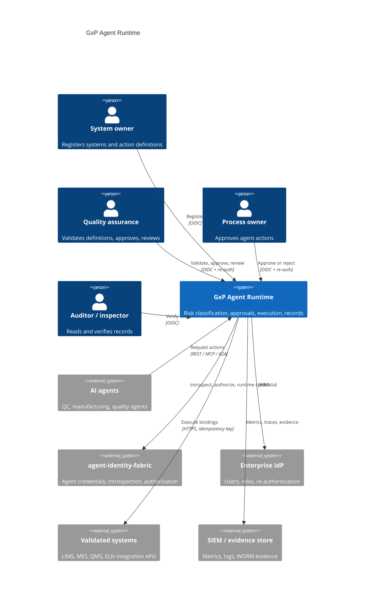
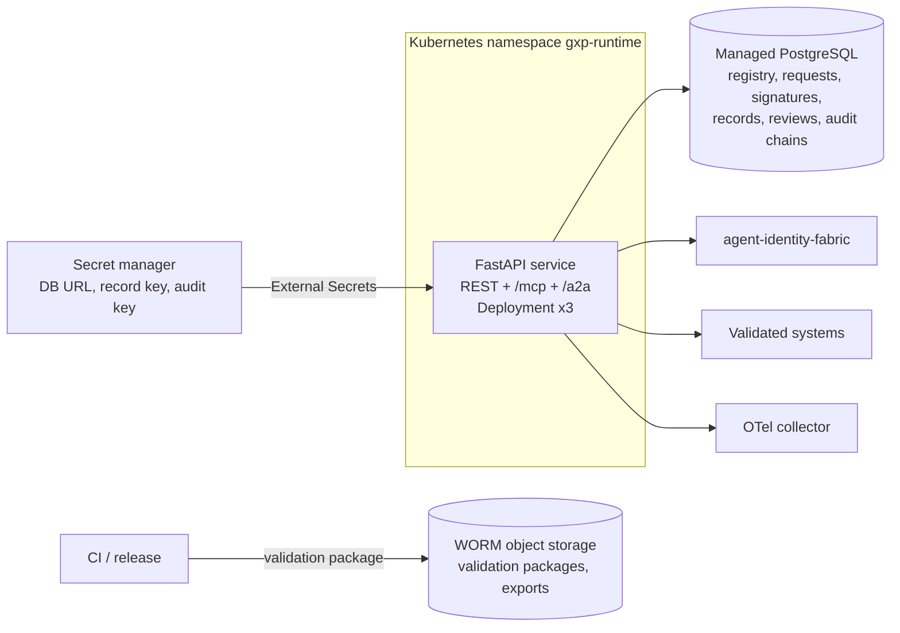
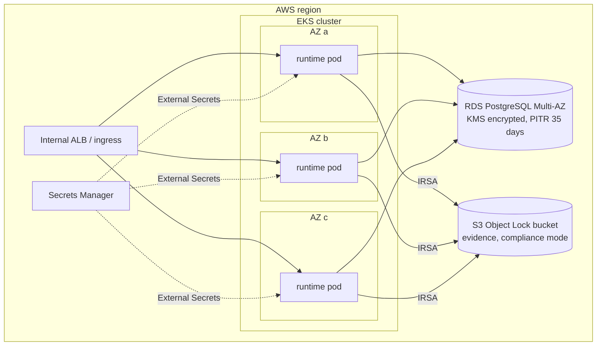

# Architecture

## Business problem

BioPharma quality and manufacturing teams want agents to do routine work in
validated systems: release reviewed QC results, file investigation comments,
check sample status, raise change records. Every one of those systems is in a
validated state, and every record it holds is a GxP record subject to
21 CFR Part 11, EU GMP Annex 11 and data-integrity expectations. An agent
calling a LIMS API directly bypasses the controls that keep the system
validated: there is no approved specification of what the agent may do, no
risk assessment, no accountable human signature, and no record an inspector
would accept. The runtime puts those controls between agents and validated
systems so agents can be used without re-validating the systems they touch.

## System context (C4 level 1)



## Containers (C4 level 2)



## Components (C4 level 3)

| Layer | Module | Responsibility |
|---|---|---|
| API | `api.routes`, `api.app`, `api.mcp_server`, `api.a2a` | HTTP contract, caller resolution (human vs agent), MCP tools, A2A JSON-RPC, correlation IDs, metrics |
| Application | `application.runtime.GxpRuntime` | Use cases: registry, submit, preview, execute, sign, verify, periodic review, expiry; audit every outcome |
| Application | `application.signatures.SignatureService` | Challenges, re-authentication check, single-use consumption, manifest signing |
| Domain | `domain.models`, `domain.risk`, `domain.alcoa` | Aggregates and lifecycles, GAMP 5 risk method, ALCOA+ checks |
| Security | `security.humans`, `security.agents`, `security.jwks`, `security.keys` | Enterprise OIDC users and re-authentication, agent gateways, JWKS, Ed25519 keys |
| Integrations | `integrations.identity_fabric` | Typed fabric client and runtime credentials |
| Infrastructure | `infrastructure.database`, `infrastructure.connectors` | SQLAlchemy Core repositories with compare-and-swap, audit sink, HTTPS connector |
| Validation | `validation.traceability` | URS -> test traceability matrix and evidence package |
| Runtime | `runtime.container` | Composition root |

## Sequences

### Request, classification and approval

```mermaid
sequenceDiagram
  participant A as Agent
  participant R as Runtime
  participant F as Identity fabric
  participant P as Process owner
  participant Q as QA
  participant I as Enterprise IdP
  participant L as LIMS
  A->>R: POST /v1/action-requests (action, inputs, justification, source record)
  R->>F: introspect credential, /v1/authorize gxp:execute:lims.result.release
  F-->>R: allow / require_approval / deny
  R->>R: resolve validated definition + validated system (review not overdue)
  R->>R: GAMP 5 risk (severity x probability x detectability) -> priority high
  R->>R: ALCOA+ checks; secret scan; GxP policy -> require_approval
  R->>R: audit action.request; store request (pending_approval)
  R-->>A: 201 pending_approval, outstanding approval + quality-approval
  P->>R: POST /v1/signatures/challenges (approval)
  R-->>P: challenge_id, nonce, record digest, statement
  P->>I: re-authenticate (prompt=login, nonce)
  I-->>P: ID token (auth_time, amr, nonce)
  P->>R: POST /v1/signatures (challenge, ID token, reason)
  R->>R: verify subject, nonce, auth_time, amr; record unchanged; consume challenge
  R->>R: sign manifest (Ed25519), audit signature.apply
  Q->>R: same ceremony (quality-approval, different person)
  R->>R: CAS pending -> executing (exactly once)
  R->>L: POST binding, Idempotency-Key = request id
  L-->>R: 201 result
  R->>R: output schema, digests, record ALCOA+, sign record, audit, store, read back
  R-->>Q: signature + completed + execution record id
```

### Low-risk autonomous action

A reversible read with low impact on all three GxP concerns, run by a
category 4 function with high detectability, classifies as risk class 3 and
priority low. Policy rule `allow-scoped-low-risk` allows it; the runtime
executes immediately and still produces a signed execution record.

### Definition lifecycle and periodic review

Definitions are registered as drafts by a system owner. A QA signature with
meaning `validation-approval` by someone other than the author validates the
exact spec digest. New versions must be higher; retiring a version requires a
QA `retirement` signature. Periodic reviews summarise a period and are approved
with a QA `review` signature (not by the generator); approval resets the
review clock and keeps the system validated or suspends it when remediation
is required.

## Deployment view (AWS reference)



Replicas are stateless and spread across zones; the PDB keeps two available
during voluntary disruption; PostgreSQL runs Multi-AZ. Azure (AKS, Flexible
Server, Key Vault, immutable Blob) and GCP (GKE, Cloud SQL, Secret Manager,
retention-locked bucket) use the same chart with the Terraform in
`deployments/terraform/{azure,gcp}`.

## Data

| Store | Data | Classification | Retention |
|---|---|---|---|
| `validated_systems`, `action_definitions` | Registry and lifecycle | CONFIDENTIAL | Life of system + record retention |
| `action_requests` | Inputs, justification, risk, policy, ALCOA+ | RESTRICTED (GxP record) | Record retention schedule (default 10 years) |
| `electronic_signatures` | Signature manifests and values | RESTRICTED (GxP record) | As the signed record |
| `execution_records` | Outputs, digests, signatures | RESTRICTED (GxP record) | As above |
| `audit_events` | Signed hash chains | RESTRICTED | As above |
| `signing_challenges` | Nonces (single use) | INTERNAL | Purgeable after expiry |
| Object Lock bucket | Validation packages, periodic review exports | RESTRICTED | Compliance-mode retention |

Credentials and re-authentication tokens are never stored or logged; the
runtime rejects requests that contain credential material.

## Observability

Prometheus metrics (`gxp_*`), OpenTelemetry traces via OTLP, JSON logs with
correlation IDs (also written into audit events), alerts in
`configs/prometheus/alerts.yaml`, dashboard in `configs/grafana/`. See
[monitoring](../runbooks/monitoring.md).

## CI/CD

GitHub Actions `ci.yml`: quality on Python 3.12 and 3.13 (ruff, black, mypy
strict, bandit, contract drift, all test suites with coverage gate, strict
validation package), PostgreSQL integration, Helm lint/render/kubeconform and
required-values check, Terraform fmt/validate for three clouds, Trivy config
scan, container build with smoke test, Trivy image scan, Syft SBOM, Grype
gate, Semgrep. `release.yml` on tags: quality gate, validation package,
image to GHCR with provenance attestation, chart to GHCR OCI, GitHub release
with SBOM, JUnit results, validation package and traceability matrix.
